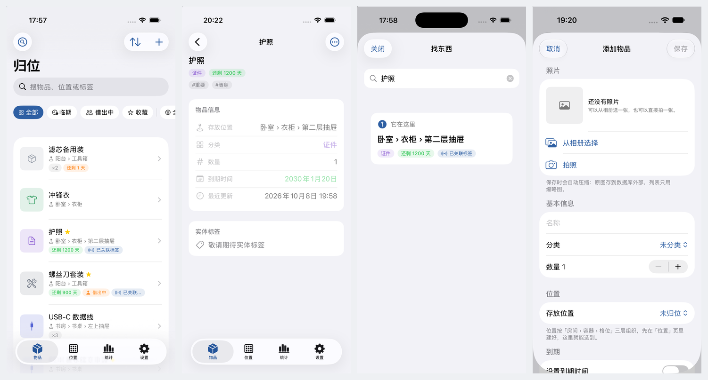

# 归位 GuiWei

一款把「东西放在哪」当作第一公民的物品管理 App。位置按 **房间 › 容器 › 格位** 三层组织，每个容器有自己的图标、颜色和备注。

对应题目：**题目一 物品管理 App（原生客户端）**

技术栈：SwiftUI + SwiftData + ActivityKit + WidgetKit + App Intents，**零第三方依赖**，全部使用苹果原生框架。



## 功能

**基础**
- 物品的添加 / 查看 / 编辑 / 删除（左滑删除带二次确认）
- 名称、分类、数量、存放位置、到期时间、标签、备注、图片（相册 + 相机）
- SwiftData 本地持久化，杀掉 App 或重启设备后数据仍在
- 状态筛选（全部 / 临期 / 借出中 / 收藏）+ 分类筛选 + 四种排序 + 全文搜索（名称/位置/标签/分类/备注）

**进阶**
- 到期前 7 天本地通知；借用到期当天提醒
- 独立分类模型（图标 + 颜色 + 排序）、标签、Charts 三张统计图
- **桌面小组件**（WidgetKit）与**借出实时活动 / 灵动岛**（ActivityKit）
- 相机、系统分享（ImageRenderer 分享卡片 + ShareLink）、Siri 快捷指令、深链
- 图片两级存储：原图 `@Attribute(.externalStorage)` + 缩略图内联，写入前压缩并做解码缓存

**体验**
- 首次启动：选择外观 → 5 页新手指南 → 主界面
- 外观支持 跟随系统 / 自动（按时间）/ 浅色 / 深色
- 两种使用形态：**演示版**（预置数据）与**实用版**（空白起步），设置页可一键切换

**差异化**
- 「找东西」：输入名字直接回答"它在哪"，借出去了就回答"在谁手里"
- 借出 / 归还记录，逾期状态标色
- 位置树递归汇总数量，容器可单独配色

## 运行

### 用 Xcode（推荐）

打开 `GuiWei.xcodeproj`，选 `GuiWei` scheme，直接 `⌘R`。

首次在真机上运行需要：登录 Apple ID → 为**两个 target**（`GuiWei` 与 `GuiWeiWidgetExtension`）选择 Team，并把 Bundle Identifier 改成你自己的（扩展的 ID 必须是主 App 的 ID 加 `.widget` 后缀）。

### 用命令行

```bash
cd GuiWei

xcodebuild build \
  -project GuiWei.xcodeproj -scheme GuiWei -configuration Debug \
  -sdk iphonesimulator -destination 'generic/platform=iOS Simulator' \
  -derivedDataPath "$PWD/.build" \
  CODE_SIGNING_ALLOWED=NO CODE_SIGNING_REQUIRED=NO \
  OTHER_SWIFT_FLAGS="-disable-sandbox"

xcrun simctl install booted .build/Build/Products/Debug-iphonesimulator/GuiWei.app
xcrun simctl launch booted com.tianhaoming.guiwei
```

> `-disable-sandbox` 是命令行环境下的沙盒适配。用 Xcode 图形界面时**不需要**。

## 两种使用形态

| 形态 | 初始数据 | 用途 |
| --- | --- | --- |
| 实用版（默认） | 物品与位置为空 | 日常使用 |
| 演示版 | 12 件物品、11 个位置、2 条借出记录 | 展示与汇报 |

默认形态由编译条件 `DEMO_DATA` 决定：不加编译条件 = 实用版，加上 = 演示版。
设置页「数据 → 使用形态」里也能随时切换，选择会持久保存。

分类（8 个内置）两种形态都保留——它属于 App 的分类体系，不是示例内容。

## 调试用启动参数（仅 Debug 生效）

模拟器里不方便手动点击时，可以用启动参数直接跳到指定界面：

```bash
BID=com.tianhaoming.guiwei

xcrun simctl launch booted $BID -startTab stats       # 直接打开统计页
xcrun simctl launch booted $BID -startNew 1           # 打开添加物品表单
xcrun simctl launch booted $BID -startFind "护照"      # 打开「找东西」并搜索
xcrun simctl launch booted $BID -startItem <uid>      # 跳到某件物品详情
xcrun simctl launch booted $BID -startNew 1 -openLibrary 1   # 直接弹出相册选择器
xcrun simctl launch booted $BID -startNew 1 -openCamera 1    # 直接弹出相机

xcrun simctl launch booted $BID -skipOnboarding 1     # 跳过首次启动流程
xcrun simctl launch booted $BID -showAppearance 1     # 只看外观选择页
xcrun simctl launch booted $BID -onboardingPage 3     # 新手指南跳到第 3 页
xcrun simctl launch booted $BID -dataMode demo        # 临时切到演示版（不改写偏好）
xcrun simctl launch booted $BID -openLendSheet 1      # 直接打开借出表单
xcrun simctl launch booted $BID -startLiveActivity 1  # 开启借出实时活动
xcrun simctl launch booted $BID -guiwei.appearance dark   # 临时指定外观
```

这些入口都用 `#if DEBUG` 包着，Release 构建里不存在。`-dataMode` 只影响当次运行的数据，用完会把使用者原本的形态偏好放回去。

> 给模拟器相册塞测试照片：`xcrun simctl addmedia booted <图片路径>`

## 目录结构

```
GuiWei/
├── Models/                  Item / StorageSpot / ItemCategory / LoanRecord
├── Services/                容器、路由、外观与形态、示例数据、图片管线、
│                            通知、小组件快照
├── LiveActivity/            借出实时活动的数据模型与开关
├── Intents/                 App Intents 与 Siri 短语
├── Support/                 Theme（间距、圆角、字体、状态色）
├── Views/
│   ├── Items/               列表 / 详情 / 编辑器 / 借出 / 找东西
│   ├── Spots/               位置列表 / 详情 / 编辑器
│   ├── Stats/               统计图表
│   ├── Settings/            设置
│   ├── Share/               分享卡片
│   ├── Onboarding/          外观选择 + 5 页新手指南
│   └── Components/          通用组件、相机封装
└── Screenshots/             各阶段实机截图

GuiWeiWidgetExtension/       小组件扩展 target：桌面小组件 + 实时活动（灵动岛）
GuiWei.xcodeproj/            工程文件（含共享 scheme）
```

## 苹果生态集成

| 能力 | 状态 |
| --- | --- |
| Siri / 快捷指令（3 个 intent + 中文短语） | 已实现 |
| 本地通知（临期 / 借用到期） | 已实现 |
| 系统分享（渲染分享卡片） | 已实现 |
| 深链 `guiwei://`（8 条路由） | 已实现 |
| 桌面小组件（WidgetKit） | 已实现，扩展 target 已挂载 |
| 实时活动 / 灵动岛（ActivityKit） | 已实现，两种场景，见下 |
| 实体标签（AirTag） | 界面占位「敬请期待实体标签」 |
| iCloud 同步 | 数据结构已就绪，未启用 |

### 关于实体标签

Apple **没有**向第三方 App 开放 AirTag 的枚举、配对与位置读取接口。AirTag 只能在系统「查找」App 内绑定；硬件厂商要让配件接入「查找」网络需要 MFi 资质。

早期版本曾实现过"保存关联关系 + 跳转系统「查找」"的方案，但关联关系本身对用户没有实际价值（既不能校验标签是否存在，也不能做任何后续动作），却会让人误以为 App 支持 AirTag。因此该功能已**整体移除**，改为在界面上明确显示「敬请期待实体标签」。

### 关于灵动岛

灵动岛只显示**一件事**——现在最该处理的那件东西：

| 优先级 | 挑什么 | 
| :---: | --- |
| **1** | 最近的**到期**物品（30 天内或已过期） |
| **2** | 最近的**归还**（借出且约定了应还日期） |
| — | 两类都没有 → 不显示，腾出灵动岛 |

**只要还有东西要到期，就绝不显示归还。**

#### 三种状态的显示

| 状态 | 内容 |
| --- | --- |
| **紧凑态**（平时） | 左：**物品名前两个字**（如「酸奶」）· 右：`2天` / `今天` / `逾期` |
| **展开态**（长按） | 物品名、位置或借给谁、时间进度条、另有几件、**「知道了」按钮** |
| **锁定屏** | 圆形图标 + 完整信息 + 进度条 |

紧凑区刻意**放物品名而不是图标**——只看一个时钟图标和「3天」，用户不知道是什么东西要到期。

#### 三条使用规则

**1. 离开 App 后不长期占用灵动岛**

| 机制 | 说明 |
| --- | --- |
| 离场宽限期 | 退到后台时把活动设为 **10 分钟后自动移除** |
| 手动收起 | 长按灵动岛点「知道了」立刻移除 |

> **为什么不能"杀后台就立刻删除"**：实测确认，App 被从后台划掉时**收不到任何回调**
> （`applicationWillTerminate` 不会被调用），而且 iOS 本身也**不会自动结束**实时活动——
> 强杀后重新打开，活动仍然是「1 条」。所以只能给它一个宽限期，另外提供手动收起的入口。

**2. 一眼看出是什么要到期**：紧凑区显示物品名，不只是一个时间和图标。

**3. 智能**

- 只挑**一件**最紧急的，而不是把清单塞进去
- 逾期 → `逾期` + 红色；今天 → `今天`；其余 → `N天`
- 30 天内没有要处理的事就**完全不显示**，不占地方
- 倒计时用 `Text(due, style: .relative)`，**系统自动刷新**，不需要唤醒 App
- 新建活动前会清掉"已结束但未移除"的旧活动，避免多个活动并存导致灵动岛退化成最简态

#### 刷新时机

打开 App、回到前台、退到后台，以及借出 / 归还 / 编辑物品之后。

> **ActivityKit 要求 App 在前台才能新建实时活动**，所以活动是在 App 运行时创建并保持的。
> iOS 不会在 App 前台时显示它自己的实时活动，所以挂着不干扰——**一旦切出去，它立刻就在灵动岛上了**。

#### 灵动岛宽度适配

iPhone 17 Pro 与 18 Pro 的灵动岛宽度不同：

1. 紧凑态与最简态只放「两个汉字 + 三个字以内」，任何机型都不会被裁切；
2. 展开态里较长的内容用 `.dynamicIsland(verticalPlacement: .belowIfTooWide)`，宽度不够时系统自动换行到下方；
3. 需要完整信息的场景交给锁定屏。

### 关于 Siri

设计了 6 组快捷短语，**不需要先在「快捷指令」里配置**，装完即可用：

| 说法 | 需要几轮 |
| --- | --- |
| 「归位护照放哪了」 | **一轮**（短语里嵌了物品实体，Siri 直接解析） |
| 「归位什么快过期了」 | **一轮** |
| 「归位汇报一下物品情况」 | **一轮** |
| 「用归位记一件东西」 | 一轮（只问"记什么"，位置已改为可选） |
| 「归位把充电器换个位置」 | 两轮（Siri 追问新位置） |
| 「归位把充电器借出去」 | 两轮（Siri 追问借给谁） |

**App Intents 的硬性限制**：一条快捷短语里**只能嵌一个参数**，而且必须是 `AppEntity` 或 `AppEnum`，
不能用普通字符串。所以「物品」被做成了 `ItemEntity`（带模糊匹配的 `EntityStringQuery`），
这也是「归位护照放哪了」能做到一句话直达的原因。

回答时除了语音，还会显示一张**自绘的结果卡片**（Siri 回答区），比纯文字更像「归位」自己的界面。

### 关于灵动岛（旧）

实时活动的 UI 必须放在 Widget Extension 里，因此工程包含 `GuiWeiWidgetExtension` 这个扩展 target。灵动岛的紧凑区域很窄，所以只放「一个图标 + 最多三个字」；较长的内容用 `.dynamicIsland(verticalPlacement: .belowIfTooWide)`，宽度不够时系统会自动把它放到下方一行。

> 注意：无界面的模拟器（headless）不会把灵动岛合成进截图，验证实时活动是否开启请看设置页「与系统集成 → 借出实时活动」的状态。

## 支持的深链

| 链接 | 动作 |
| --- | --- |
| `guiwei://items` / `spots` / `stats` / `settings` | 切换到对应页签 |
| `guiwei://find?q=护照` | 打开「找东西」并预填关键词 |
| `guiwei://search?q=牛奶` | 打开物品页并搜索 |
| `guiwei://new` | 打开添加物品表单 |
| `guiwei://item/<uid>` | 跳到某件物品详情 |

## 设计规范

- 间距只用 4 的倍数：4 / 8 / 12 / 16 / 24
- 圆角统一在 `Theme` 里定义：12（缩略图、搜索框）、14（按钮）、20（卡片）、28（弹出的 sheet）
- 字号只用语义字号（`.body`、`.footnote`、`.caption`…），不写死磅值；数字额外使用 SF Pro Rounded
- 颜色只用语义色与状态色（绿=正常、橙=临期、红=过期、灰=归档）
- 可点区域不小于 44×44
- 层级靠分组背景色差表达，几乎不用阴影
- 深色模式完整适配；「自动」模式按 07:00–19:00 浅色、其余深色切换

以上常量集中在 `Support/Theme.swift`。

## 已知边界

- **免费 Apple ID 的证书 7 天过期**，到期后重新运行一次即可，数据不会丢。
- **桌面小组件与实时活动跟随系统外观**，不受 App 内外观设置影响——它们运行在独立进程，读取 App 偏好需要 App Group，而 App Group 要求付费开发者账号。
- **分类没有增删改界面**，只有 8 个内置分类。
