<div align="center">

# 归位 GuiWei

**一款把「东西放在哪」当作第一公民的物品管理 App**

记录每一件东西的物理坐标：它在哪个房间、哪个容器、哪一层格位。

<sub>对应题目：题目一 物品管理 App（原生客户端）　·　冰岩实习 2026.09.26 – 10.11</sub>

<br>


</div>


---

## 这是什么

普通清单类 App 让你给物品贴一个"分类"或"标签"，但**真正要找东西的时候，你需要知道的是它在哪一格**。

「归位」把位置做成数据结构的第一公民：**房间 › 容器 › 格位** 三层树，每件物品落到具体格位。找东西时不是给你一个列表，而是直接回答"它在卧室 › 衣柜 › 第二层抽屉"；如果借出去了，就回答"在隔壁阿哲手里"。

技术上全部使用苹果原生框架，**没有任何第三方依赖**。

---

## 界面

| 物品列表 | 物品详情 | 位置三层树 | 统计图表 |
| :---: | :---: | :---: | :---: |
| 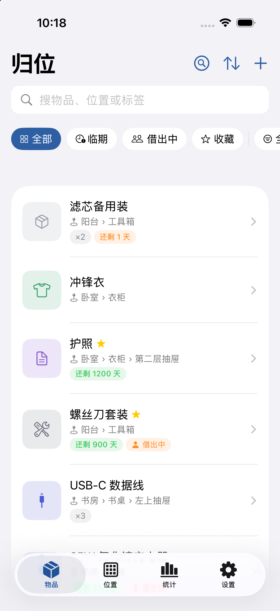 | 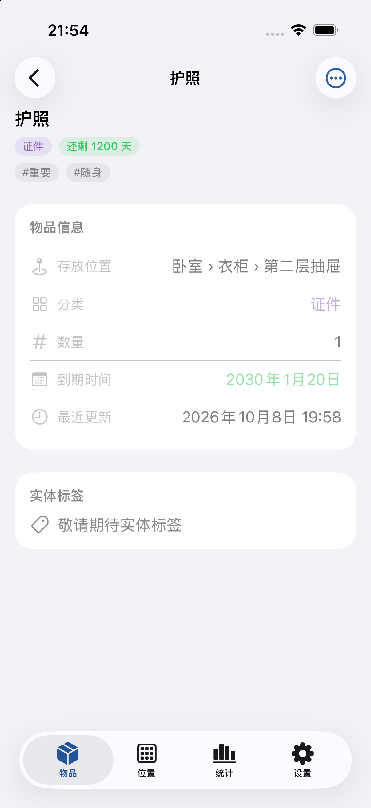 | 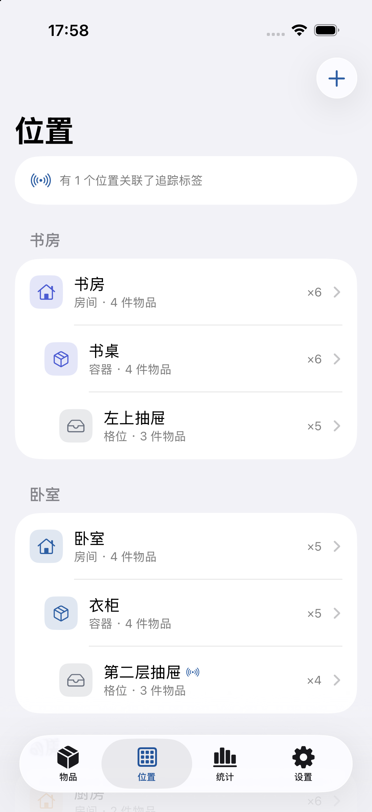 | 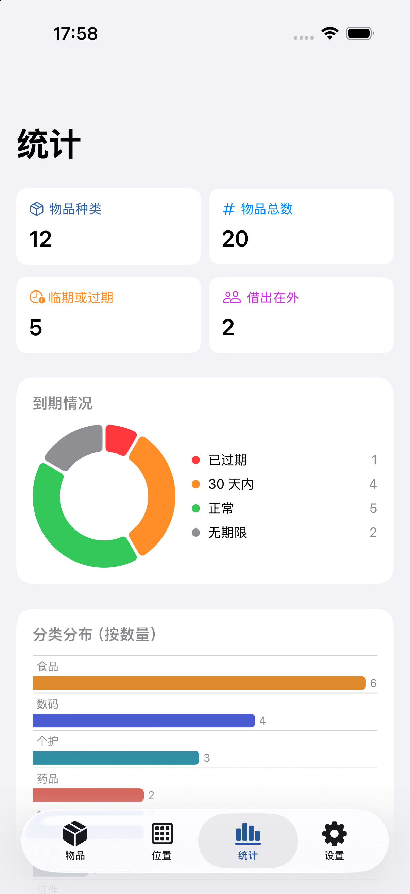 |
| **找东西** | **添加物品** | **借出登记** | **设置** |
| 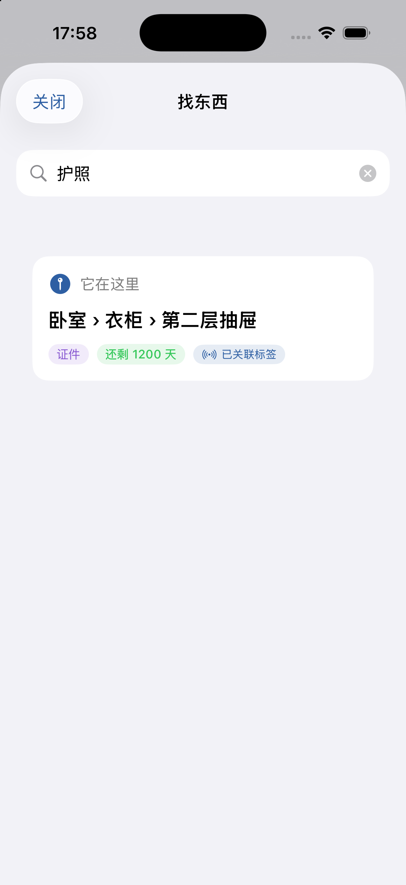 | 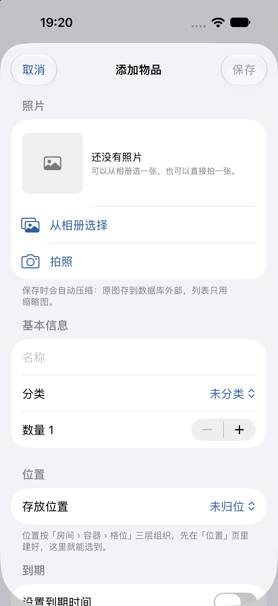 | 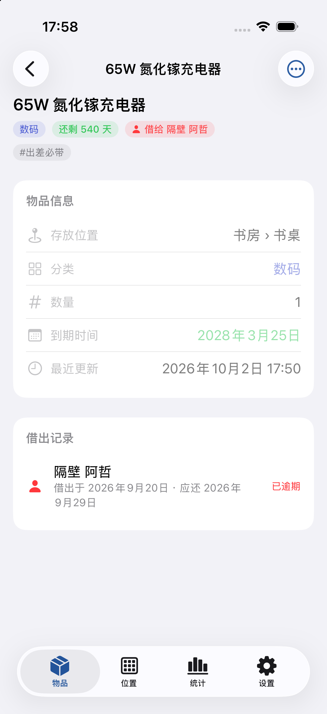 | 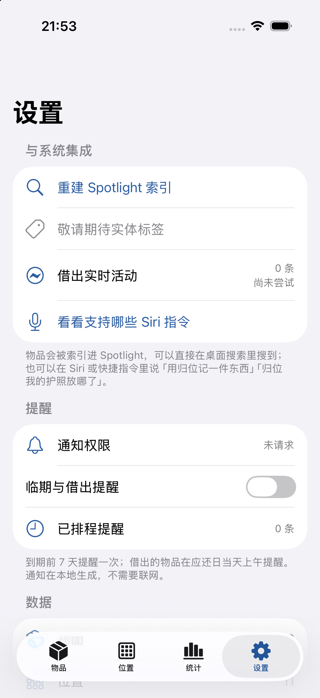 |

### 首次启动

| 第 1 步：选择外观 | 第 2–5 步：新手指南 | 深色模式 |
| :---: | :---: | :---: |
| 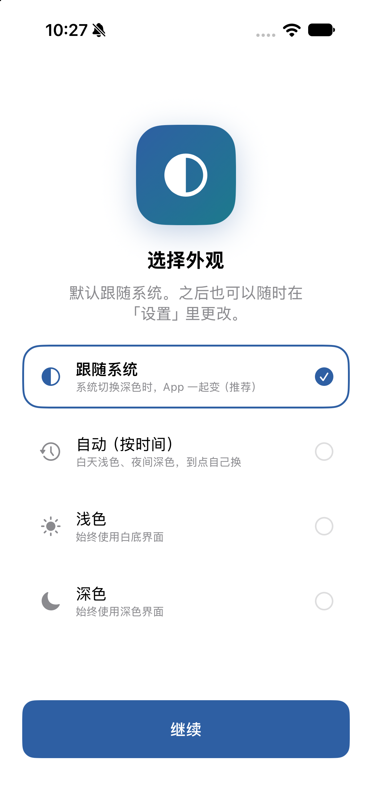 | 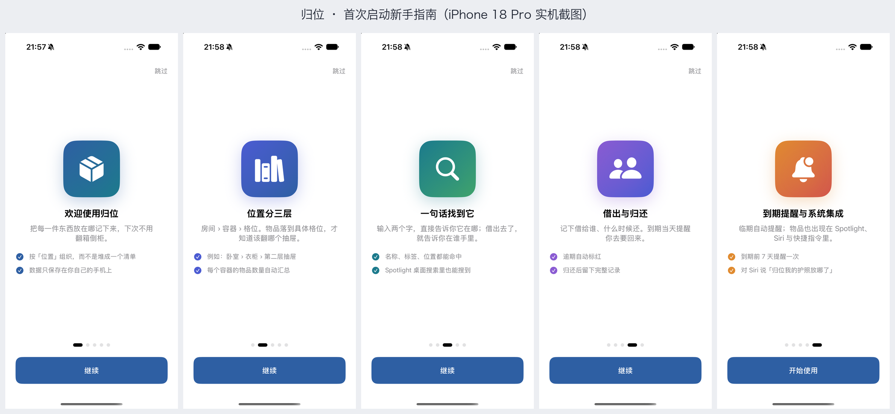 | 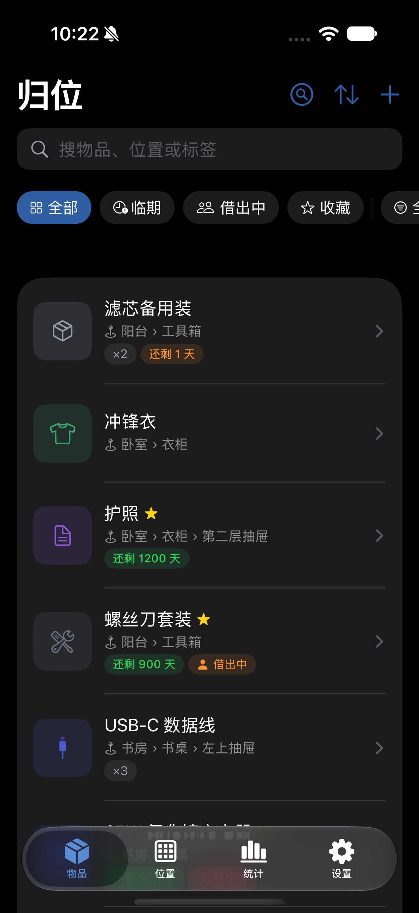 |

---

## 功能

### 基础
- 物品的**添加 / 查看 / 编辑 / 删除**（左滑删除带二次确认）
- 字段：名称、分类、数量、存放位置、到期时间、标签、备注、图片（相册 + 相机）
- **SwiftData 本地持久化**，杀掉 App 或重启设备后数据仍在
- 状态筛选（全部 / 临期 / 借出中 / 收藏）+ 分类筛选 + 四种排序 + 全文搜索

### 进阶
- 到期前 7 天本地通知；借用到期当天提醒
- 独立分类模型（图标 + 颜色 + 排序）、标签、Charts 统计图表
- **桌面小组件**（WidgetKit）与**借出实时活动 / 灵动岛**（ActivityKit）
- 相机、系统分享（`ImageRenderer` 渲染分享卡片 + `ShareLink`）、Siri 快捷指令、深链
- 图片两级存储：原图 `@Attribute(.externalStorage)` + 缩略图内联，写入前压缩并做解码缓存

### 差异化
- **「找东西」**：输入名字直接回答"它在哪"；借出去了就回答"在谁手里"
- **借出 / 归还记录**：把"在别人手里"当作一等状态，而不是一条备注；逾期自动标色
- **位置树递归汇总**：每个容器显示它下面所有物品的总数
- **两种使用形态**：演示版（预置数据）/ 实用版（空白起步），设置页可一键切换

---

## 苹果生态集成

| 能力 | 状态 |
| --- | :---: |
| Siri / 快捷指令（3 个 App Intent + 中文短语） | 已实现 |
| 本地通知（临期 / 借用到期） | 已实现 |
| 系统分享（渲染分享卡片） | 已实现 |
| 深链 `guiwei://`（8 条路由） | 已实现 |
| 桌面小组件（WidgetKit） | 已实现 |
| 实时活动 / 灵动岛（ActivityKit） | 已实现 |
| 实体标签（AirTag） | 界面占位，见下 |
| iCloud 同步 | 数据结构已就绪，未启用 |

**关于实体标签**：Apple 没有向第三方 App 开放 AirTag 的枚举、配对与位置读取接口。早期版本实现过"保存关联关系 + 跳转系统「查找」"，但关联关系对用户没有实际价值却会让人误以为支持 AirTag，因此已**整体移除**，改为在界面上明确显示「敬请期待实体标签」。

---

## 项目结构

```
.
├── README.md                    本文件
├── GuiWei/                      Xcode 工程
│   ├── GuiWei.xcodeproj/        含共享 scheme
│   ├── GuiWei/                  主 App target
│   │   ├── Models/              Item / StorageSpot / ItemCategory / LoanRecord
│   │   ├── Services/            容器、路由、外观与形态、图片管线、通知
│   │   ├── LiveActivity/        借出实时活动
│   │   ├── Intents/             App Intents 与 Siri 短语
│   │   ├── Support/             Theme（间距、圆角、字体、状态色）
│   │   └── Views/               物品 / 位置 / 统计 / 设置 / 分享 / 引导 / 组件
│   ├── GuiWeiWidgetExtension/   小组件扩展 target（桌面小组件 + 实时活动）
│   ├── Screenshots/             各阶段实机截图
│   └── README.md                工程细节：构建命令、调试启动参数、设计规范
├── docs/                        交付文档
│   ├── 归位App-开发日志.pdf      45 页，逐环节记录
│   ├── 归位App-介绍手册.pdf      25 页，功能与使用
│   ├── 归位App-Bug修复日志.pdf   22 页，缺陷的现象/根因/修复/验证
│   └── 学习资料/                 前置学习材料
└── demo/                        演示录像
```

---

## 怎么跑起来

### 用 Xcode（推荐）

```bash
open GuiWei/GuiWei.xcodeproj
```

选 `GuiWei` scheme，直接 `⌘R`。

首次在真机上运行需要在 Xcode 里登录 Apple ID，并为**两个 target**（`GuiWei` 与 `GuiWeiWidgetExtension`）选择 Team、填写自己的 Bundle Identifier（扩展的 ID 必须是主 App 的 ID 加 `.widget` 后缀）。

### 用命令行

```bash
cd GuiWei

xcodebuild build \
  -project GuiWei.xcodeproj -scheme GuiWei -configuration Debug \
  -sdk iphonesimulator -destination 'generic/platform=iOS Simulator' \
  -derivedDataPath "$PWD/.build" \
  CODE_SIGNING_ALLOWED=NO CODE_SIGNING_REQUIRED=NO

xcrun simctl install booted .build/Build/Products/Debug-iphonesimulator/GuiWei.app
xcrun simctl launch booted com.tianhaoming.guiwei
```

> 更多细节（调试用启动参数、设计规范、已知边界）见 [`GuiWei/README.md`](GuiWei/README.md)。

---

## 交付文档

| 文档 | 页数 | 内容 |
| --- | :---: | --- |
| [开发日志](docs/归位App-开发日志.pdf) | 45 | 从选题、需求拆解到实现与验证，逐环节记录，包含踩过的坑 |
| [介绍手册](docs/归位App-介绍手册.pdf) | 25 | 产品定位、功能清单、逐功能使用指南、技术说明 |
| [Bug 修复日志](docs/归位App-Bug修复日志.pdf) | 22 | 10 项缺陷的现象、根因分析、修复前后对比与验证记录 |
| [开发入门手册](docs/学习资料/iOS开发入门手册.pdf) | 119 | 前置学习材料：Swift 快速上手 |
| [界面设计自学手册](docs/学习资料/SwiftUI界面设计自学手册.pdf) | 121 | 前置学习材料：SwiftUI 界面设计 |
| [创意方案集](docs/学习资料/物品管理App-创意方案集.pdf) | 49 | 选题阶段的方案发散与取舍 |

---

## 已知边界

- **免费 Apple ID 的签名证书 7 天过期**，到期后重新运行一次即可，App 数据不会丢失。
- **桌面小组件与实时活动跟随系统外观**，不受 App 内的外观设置影响——它们运行在独立进程，读取 App 偏好需要 App Group，而 App Group 要求付费开发者账号。
- **分类只有 8 个内置项**，没有增删改界面。
- 深色模式完整适配；「自动」外观按 07:00–19:00 浅色、其余时间深色切换。

---

<div align="center">
<sub>GuiWei · 记录每一件东西的物理坐标</sub>
</div>
